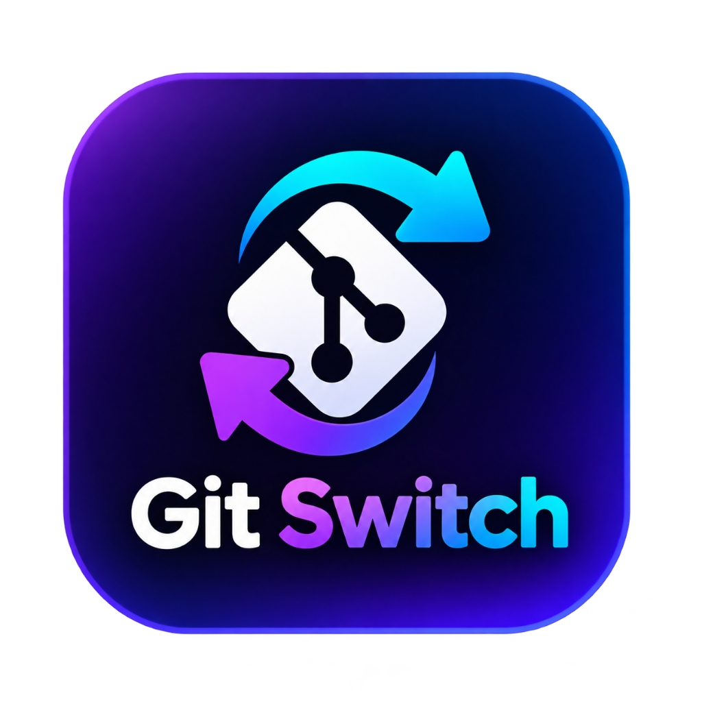

# Git Switch

<p align="center">
  
</p>

<p align="center">
  Switch Git accounts in one click — commit author, SSH, or HTTPS.
</p>

## Install

**Editor (recommended)** — [VS Code / Cursor extension](https://marketplace.visualstudio.com/items?itemName=gitswitch.git-switch-accounts)

**Desktop app** — download from [Releases](https://github.com/AJ224/Git_Switch/releases), or:

```bash
python3 git_account_switcher.py
```

Requires Git on your PATH. On Linux you may need `python3-tk`.

## How to use

1. **Add with GitHub** → approve in the browser (once per account)
2. Click the status bar (or **Switch account** in the app)
3. Pick an account → done

Tokens stay in your OS credential store (Keychain / GCM / libsecret), not in app config.

## Notes

| Mode | Updates commits | Updates push/pull |
| --- | --- | --- |
| Identity only | Yes | No |
| SSH | Yes | Yes (`ssh-add`) |
| HTTPS / GitHub | Yes | Yes (credential helper) |

- Prefer **HTTPS** remotes for accounts added with GitHub
- Does **not** switch `gh` CLI login — use `gh auth switch` separately
- Local data: `~/.gitswitch/`

## Contributing

Want to hack on the app or extension? See **[CONTRIBUTING.md](CONTRIBUTING.md)**.

MIT License — see [LICENSE](LICENSE).
